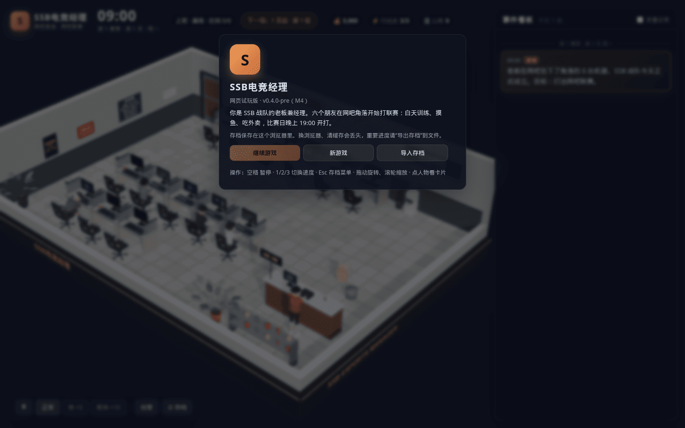
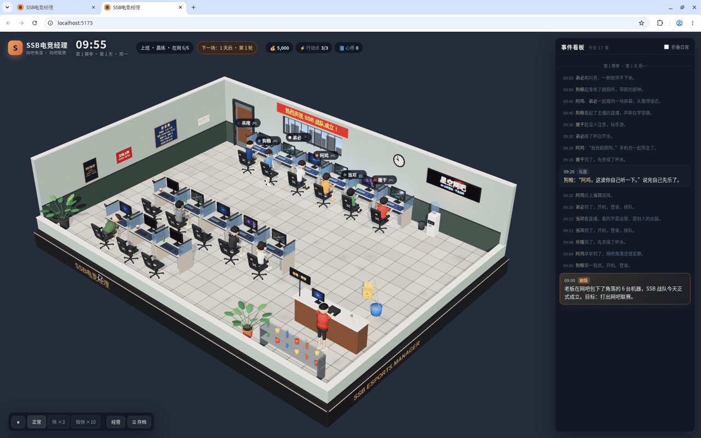
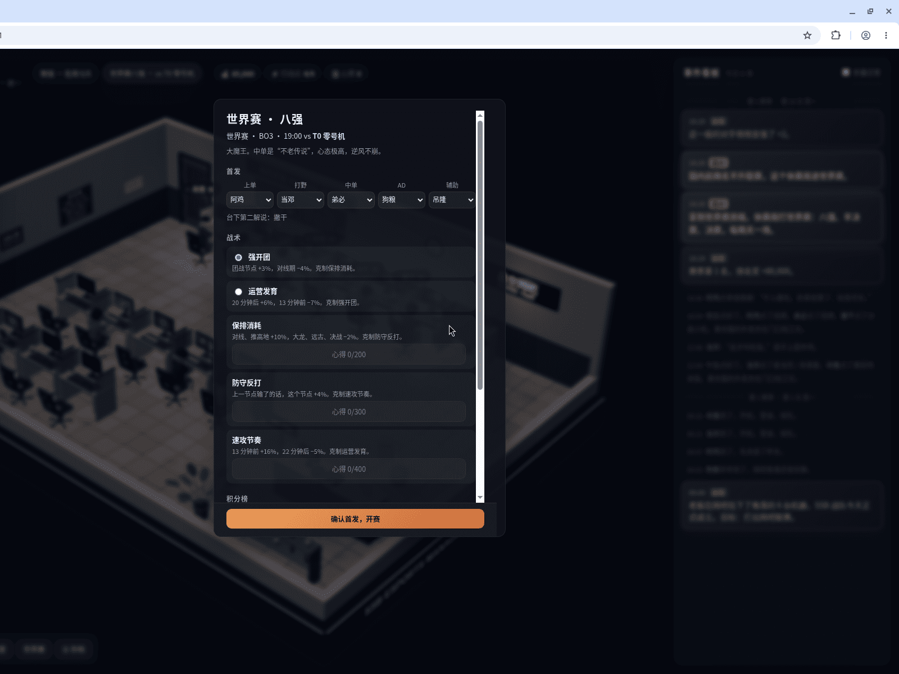
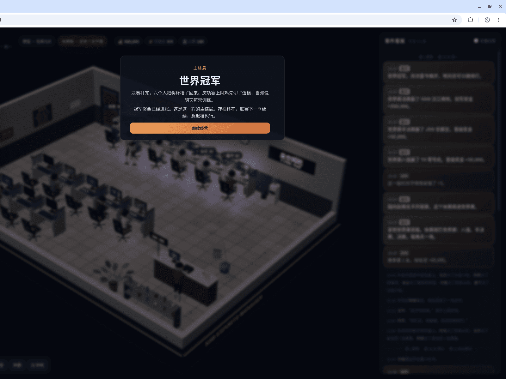

# SSB 电竞经理

六个朋友，一间网吧角落，一段慢慢打上去的赛季。

你是经理，也是老板。人不出镜，日子你看得见。最好玩的是他们怎么相处：摸鱼、互怼、甩锅、把话说开，都记在事件看板上。组队上场、把联赛打上去，是经营的那一半。

## 从网吧角落开始

开局就在**星空网吧**这一排机位，六个人：**阿鸡**、**当邓**、**狗粮**、**弟必**、**吊隆**、**撇干**。

平日是日常养成。他们按自己的脾气点外卖、刷手机、午睡、闲聊、组排。你用老板动作偶尔插手：单独谈谈、当众夸一句、点名批评、请一杯喝的。话说重了，他们会别扭一阵。

比赛日忙一些。赛前排好首发和战术，晚上一起看直播。联赛有升降级，从网吧打到城市，再到国内。国内前两名在休赛周打世界赛。夺冠会迎来一场结局；点「继续经营」，这支队伍还在。

## 里面长这样

开始菜单。新的一局从这里进，也可以接着上次的存档。



网吧角落。六个人坐在星空网吧，今天发生的事写在右边。



赛前首发。世界赛开打前排阵容和战术。



世界赛冠军。打完这场，还可以选择继续经营。



## 怎么玩

网页版，一个 HTML 就能开。

- 下载预发布单文件：[v0.4.0-pre](https://github.com/zuidkust/ssb-esports-manager/releases/tag/v0.4.0-pre)（`SSB-esports-manager-v0.4.0-pre.html`，双击打开）
- 或在仓库里自己构建后，双击 `game/dist/index.html`：

```bash
cd game && npm run build
```

第一次构建前，先在 `game/` 里 `npm install`。

空格暂停，`1` `2` `3` 改变流速。点人物看他最近在忙什么，顶部「经营」做老板的事。

## 给一起做的人

```
game/    网页版
docs/    设计文档与人设
data/    事件数据
tools/   小工具
```

- 设计：[设计文档 v0.3](docs/SSB电竞经理-设计文档-v0.3.md)
- 网页版说明：[game/README.md](game/README.md)
- License：未定。人物素材请勿擅自商用。
